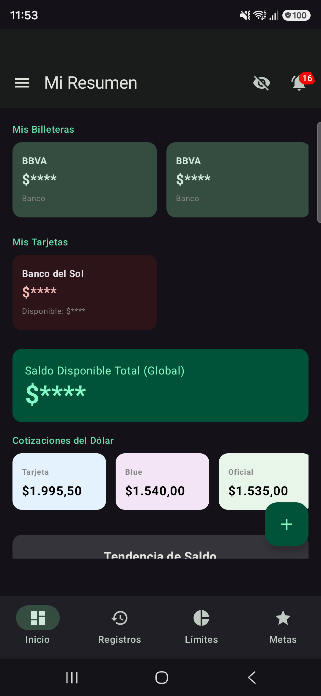
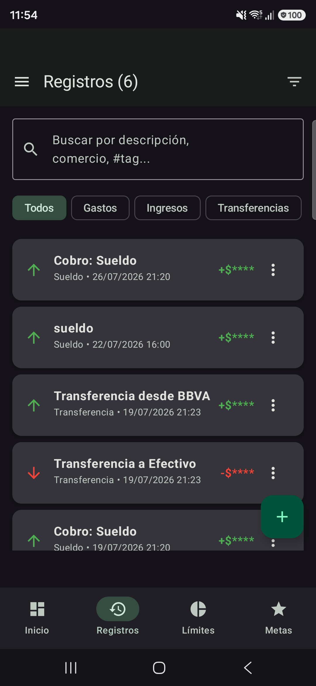
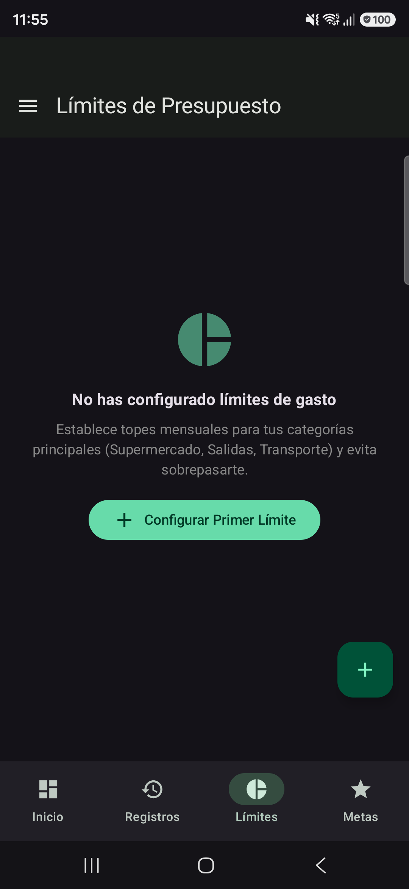
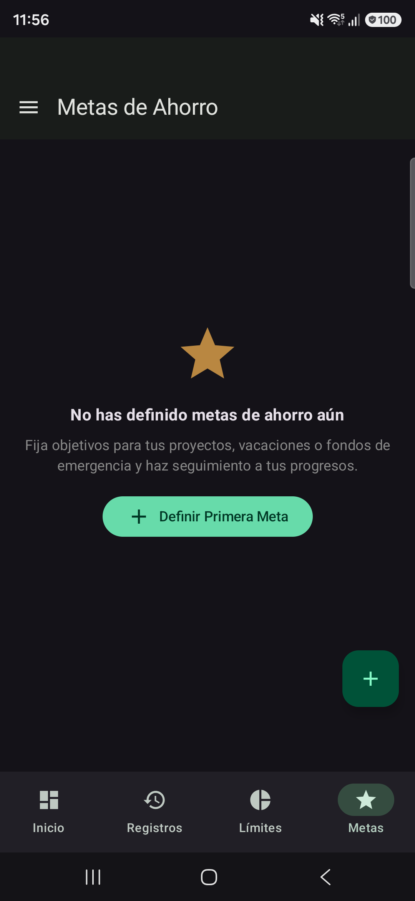
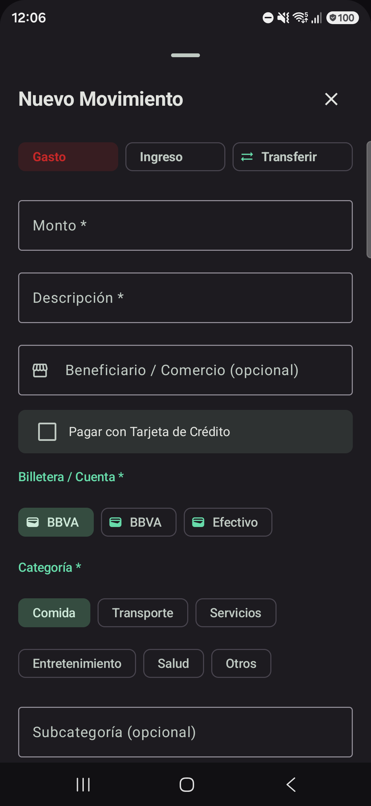
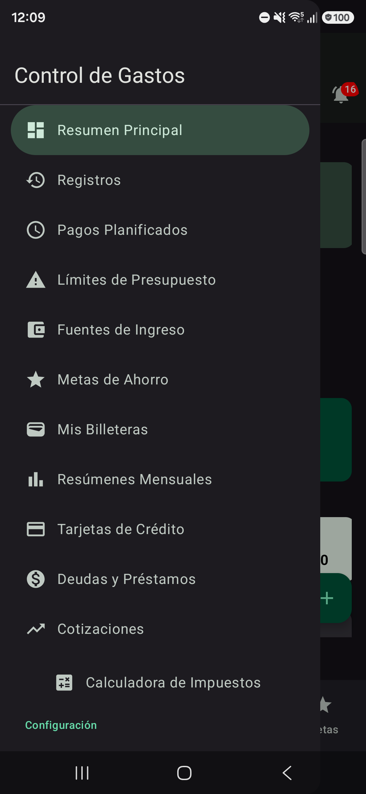
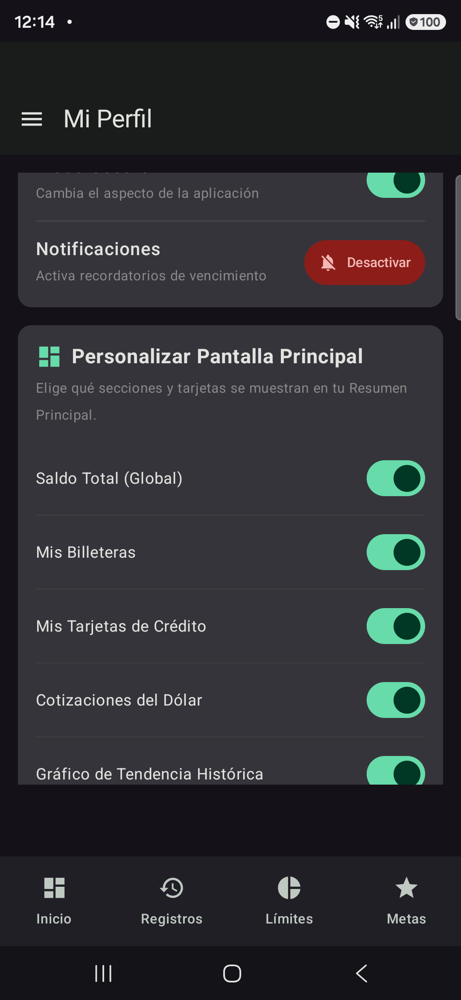
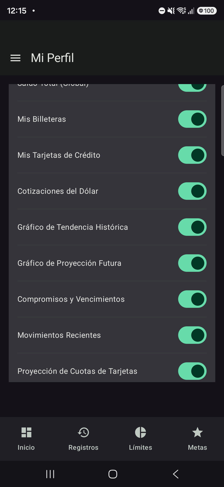

# 📱 Presupuesto Mensual — Asistente de Finanzas Personales para Android

[-3DDC84?style=for-the-badge&logo=android&logoColor=white)](https://developer.android.com)

**Presupuesto Mensual** es una aplicación móvil nativa para Android diseñada para actuar como un asistente integral de finanzas personales, gestión presupuestaria y control de flujo de caja en tiempo real. 

Construida con arquitectura moderna **MVVM**, interfaz declarativa con **Jetpack Compose (Material You)**, sincronización en la nube con **Firebase Realtime Database** y protección biométrica de grado hardware.

---

## 📸 Galería de la Aplicación (UI & Experiencia de Usuario)

> [!TIP]
> Capturas de pantalla tomadas en alta resolución (1080×2340) con el **Modo Privacidad activo** (cifras sensibles enmascaradas con `$****` para máxima confidencialidad).

| 01. Dashboard Principal | 02. Historial de Registros | 03. Límites Presupuestarios | 04. Metas de Ahorro |
| :---: | :---: | :---: | :---: |
|  **Resumen principal:** Saldos protegidos, cotizaciones, navegación y accesos rápidos |  **Historial de movimientos:** Buscador en vivo, filtros por chip y montos protegidos |  **Límites mensuales:** Topes por categoría con barras de alerta preventiva en tiempo real |  **Metas de ahorro:** Definición de objetivos financieros y seguimiento de avance porcentual |

| 05. Nuevo Movimiento | 06. Menú Lateral | 07. Mi Perfil | 07b. Switches de Personalización |
| :---: | :---: | :---: | :---: |
|  **ModalBottomSheet:** Registro ágil de ingresos, gastos y transferencias |  **Navigation Drawer:** Acceso a módulos y switch directo de Modo Privacidad |  **Mi Perfil:** Preferencias de cuenta, seguridad biométrica y personalización |  **Personalización:** Interruptores dinámicos para visibilidad de módulos en Dashboard |

---

## 🚀 Módulos y Funcionalidades Principales

### 1. 💼 Gestión Multibilletera & Cuentas
* **Control segregado de fondos:** Administra cuentas bancarias, billeteras virtuales (Mercado Pago, fintechs) y efectivo físico de manera independiente.
* **Transferencias atómicas entre billeteras:** Registro ágil de movimientos entre cuentas con actualización automática de saldos e historial de conciliación.
* **Modo Privacidad en un toque:** Oculta los balances visibles en pantalla mediante máscaras de puntos para mayor seguridad en espacios públicos.

### 2. 📊 Presupuestos & Límites Dinámicos
* **Topes mensuales por categoría:** Establece límites personalizados de gastos (comida, entretenimiento, servicios, transporte, etc.).
* **Monitoreo de umbrales en tiempo real:** Barras de progreso y feedback visual con alertas preventivas al aproximarse o exceder el presupuesto configurado.

### 3. 💳 Tarjetas de Crédito, Cuotas & Proyecciones
* **Gestión de plásticos:** Configuración de fechas de cierre, fechas de vencimiento y límites de crédito asignados.
* **Simulador y proyección de cuotas:** Cálculo automático de cuotas futuras pendientes, desglose de impacto en resúmenes mensuales venideros y amortizaciones.

### 4. 🔄 Gastos e Ingresos Recurrentes
* **Automatización periódica:** Registro de sueldos, alquileres, servicios esenciales y suscripciones fijas.
* **Confirmación ágil:** Opciones de cobro/pago asistido para consolidar los movimientos del período con un solo toque.

### 5. 🗓️ Pagos Planificados & Recordatorios
* **Agenda de vencimientos:** Control de compromisos financieros futuros ordenados por fecha límite.
* **Notificaciones en segundo plano:** Integración con **Android WorkManager** para emitir alertas push de vencimientos antes de la fecha límite, incluso con la app cerrada.

### 6. 🎯 Metas de Ahorro
* **Objetivos financieros:** Definición de metas de ahorro a corto, mediano y largo plazo.
* **Seguimiento visual del progreso:** Registro de aportes periódicos y cálculo de porcentaje completado contra el objetivo fijado.

### 7. 💱 Cotizaciones & Calculadora Impositiva
* **Monedas múltiples:** Soporte y conversión de balances en diversas divisas con consulta de tipos de cambio.
* **Calculadora impositiva:** Herramienta ágil integrada para estimación de recargos y percepciones en compras internacionales o servicios digitales.

### 8. 📈 Analítica Visual & Reportes
* **Gráficos interactivos:** Distribución de egresos mediante gráficos de torta dinámicos (*Pie Charts*), gráficos de barras comparativos (*Bar Charts*) y líneas de tendencia histórica (*Trend Lines*).
* **Resúmenes mensuales:** Comparativas de ingresos vs. egresos de períodos previos para auditar la evolución del ahorro.

### 9. 🔒 Seguridad Biométrica & Cloud Sync
* **Autenticación Biométrica:** Desbloqueo mediante huella dactilar o reconocimiento facial aprovechando la API oficial `androidx.biometric.BiometricPrompt`.
* **Google Sign-In moderno:** Inicio de sesión fluido con el nuevo **Credential Manager** de Android.
* **Persistencia en la nube:** Base de datos en tiempo real de Firebase con soporte offline local y sincronización inmediata multi-dispositivo.

---

## 🛠️ Stack Tecnológico & Arquitectura

| Capa / Componente | Tecnología | Descripción |
| :--- | :--- | :--- |
| **Lenguaje** | **Kotlin 2.0** | Tipado estricto, extensiones idiomáticas y corrutinas |
| **Framework UI** | **Jetpack Compose** | Interfaz declarativa moderna con animaciones y Material You |
| **Diseño** | **Material 3 (M3)** | Tipografías escalables, paleta adaptativa y soporte para modo oscuro |
| **Arquitectura** | **Clean MVVM** | Model-View-ViewModel desacoplado con Repositorios y `StateFlow` |
| **Base de Datos** | **Firebase Realtime Database** | Persistencia reactiva en tiempo real con reglas de seguridad RLS |
| **Autenticación** | **Firebase Auth & Credential Manager** | Flujo de acceso federado por Google y credenciales de sesión |
| **Tareas en Background** | **WorkManager (`androidx.work`)** | Tareas asíncronas fiables y programación de alertas |
| **Seguridad de Hardware**| **Android Biometrics** | Validación criptográfica de biometría local en el dispositivo |

---

## 📦 Descarga e Instalación del APK

La versión compilada y lista para instalar se encuentra publicada oficialmente en la sección de **[GitHub Releases](https://github.com/fedehda/presupuestomensual/releases)**:

* 🚀 **Página oficial de Releases:** [Presupuesto Mensual Releases (Última versión)](https://github.com/fedehda/presupuestomensual/releases/latest)
* 📥 **Descarga directa del APK:** [PresupuestoMensual-v1.0-debug.apk](https://github.com/fedehda/presupuestomensual/releases/latest/download/PresupuestoMensual-v1.0-debug.apk) (~22.6 MB)

### Pasos para instalar en tu dispositivo Android:

1. **Descarga el archivo APK** directamente en tu celular desde el enlace superior (o descárgalo en tu PC y transfiérelo vía cable USB / Google Drive).
2. Abre el archivo `PresupuestoMensual-v1.0-debug.apk` desde las notificaciones de descarga o el explorador de archivos de tu teléfono.
3. Si el sistema te lo solicita, activa el permiso *"Permitir instalar aplicaciones de fuentes desconocidas"* para tu navegador o explorador de archivos.
4. Presiona **Instalar** y ¡listo! La aplicación se iniciará de inmediato con la pantalla de bienvenida y login.

---

## ℹ️ Aviso de Showcase Técnico

> [!NOTE]
> Este repositorio público funciona como **Showcase Técnico y Portal de Distribución** de la aplicación **Presupuesto Mensual**. Presenta la arquitectura, especificación de ingeniería y el instalable ejecutable (APK). La base de código fuente propietaria y reglas de negocio completas se gestionan de forma reservada en un repositorio privado.

---

## 👨‍💻 Autor

Desarrollado por **Federico Humada**  
* GitHub: [@fedehda](https://github.com/fedehda)  
* Portfolio: [fedehda.github.io](https://fedehda.github.io/)  
* LinkedIn: [linkedin.com/in/fedehumada](https://ar.linkedin.com/in/fedehumada)
